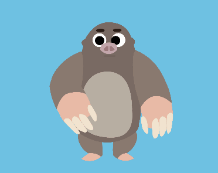
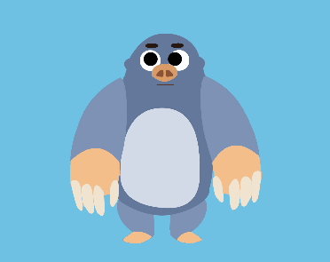

# Nugget the Mole — 2D skeletal character + asset validator (Unity)

Technical-artist portfolio piece. Two deliverables in one Unity 6 (URP 2D) project:

1. **A 2D skeletal-animated character** with a reusable prefab, a packed Sprite Atlas and a reskin variant. Built with Unity's free 2D tools only (2D Animation + 2D PSD Importer), no Spine.
2. **An editor tool that validates art assets** against project standards and exports a report.

> Unity 6000.6.7f1 · URP 2D · 2D Animation · 2D PSD Importer

| Original | Reskin |
|---|---|
|  |  |

## 1. Nugget (character)

- Source art: one layered PSD (`SP_Nugget.psd`, 11 named layers) imported with the **PSD Importer** (Individual Sprites, Use as Rig).
- Rig: bones + weights made in the **Skinning Editor**. Pieces are children of the right bones (arms follow the shoulders, not the head).
- Draw order: Order in Layer on each piece + **Sorting Group** on the root, so the character sorts as a unit.
- Animation: Animator Controller with an idle loop and a `Hesitate` trigger. The eye expression (`Neutral` / `Worried`) is animated with a **Sprite Resolver** keyed in each clip (constant tangents).
- **Reskin**: `SP_NuggetReskin.psd` is a palette-swapped copy generated by a script (`Tools/reskin_psd.py`). The rig is transferred with **Copy Rig / Paste Rig**. Two **Sprite Library Assets** (`Library_Default`, `Library_Reskin`) share the same categories and labels, and a **Prefab Variant** (`PF_NuggetReskin`) only swaps the library. Animations and rig are inherited, not duplicated.

### Draw calls (Game view > Stats, Play mode)

"Draw Calls" as reported by Stats; each number includes one draw call that is not a sprite.

| Scene | No atlas | With atlas |
|---|---|---|
| Original only | 2 | 2 |
| Reskin only | 5 | 5 |
| Both on screen | 15 | 6 |

The atlas does nothing for a single character and merges the two textures when both are on screen (15 → 6).

These numbers were measured before the eyes were switched to a single Sprite Resolver object, and have not been re-measured since, so they may differ slightly.

Open point: the reskin variant on its own makes more sprite draw calls (4) than the original (1) with the same rig and pieces. I measured it but have not found the cause yet.

## 2. Asset Validator (editor tool)

`Assets/Editor/AssetValidation/`

- `AssetValidatorRules` (ScriptableObject): the project's standards as data (naming pattern, max texture size, Read/Write, mipmaps, compression, pixels per unit).
- `AssetValidatorWindow` (EditorWindow): scans a folder, lists problems by severity, **Select** jumps to the asset, **Export report (Markdown)**.

Checks: naming (`^(SP|UI|T)_[A-Z][A-Za-z0-9]*$`), Max Size, Read/Write, mipmaps, compression, PPU (sprites sliced from a PSD included).

Sample reports (before / after fixing): [`Assets/Reports/AssetValidationBefore.md`](Assets/Reports/AssetValidationBefore.md) and [`Assets/Reports/AssetValidationAfter.md`](Assets/Reports/AssetValidationAfter.md). The "before" report was made with test textures that are not included in this repo.

**How to use:** open the window from `Tools > Asset Validator`, assign the rules asset (`AssetValidatorRules.asset`), pick the folder and press Scan.

## Limitations / not done

- No separated fingers/claws that open and close.
- The validator reports problems; it does not auto-fix them.
- Unexplained: the reskin variant makes more draw calls on its own than the original (see above).

## Process

Day-by-day decisions and mistakes: [`PROCESS_LOG.md`](PROCESS_LOG.md). Asset standards: [`STANDARDS.md`](STANDARDS.md).

Character, art and code by Daniel Pulido Segura.
